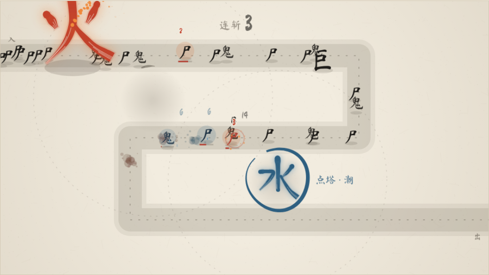

# 字形弹道原型 · 火与水

《墨守成规》玩法原型 v2。火、水两座塔的笔画直接化作招式：飞出去的就是那一点、那一竖，被用掉的笔画按笔顺写回，写回的过程就是冷却。



## 怎么运行

双击 `index.html` 即可，用浏览器的 `file://` 方式打开，不需要服务器或构建。

- 联网时会从 Google Fonts 加载「Ma Shan Zheng」书法字体和「Noto Serif SC」正文字体。断网时敌人字和数字会退回楷体或系统字体，塔身笔画不受影响，因为塔身是用笔画数据画出来的。
- 支持桌面浏览器和手机浏览器（触屏点塔放大招）。

## 怎么玩

| 操作 | 作用 |
| --- | --- |
| 点击塔 / 键盘 `Q`、`W` | 墨圈写满一圈后释放大招：火 = 焚，水 = 潮 |
| `空格` | 暂停 / 继续 |
| 表现：字形弹道 / 普通弹道 | 只换表现，机制和数值不变，用来对比 |
| 打击反馈：开 / 关 | 伤害数字、顿帧、震屏、碎字、墨渍、连斩 |
| 敌潮：稀 / 常 / 潮 | 每秒 1.6 / 3.4 / 6.5 个敌人 |
| 速度 1× / 2×、大招 手动 / 自动、出场 火+水 / 火 / 水 | 调试与观察用 |

## 招式一览

| 塔 | 笔画 | 招式 |
| --- | --- | --- |
| 火 | 左点 · 右点 | **火星**：点脱离塔身，带火尾追踪敌人，命中叠灼烧 |
| 火 | 整字 | **焚**：整个火字被掷出，落地炸开，地上留一个烧 3 秒的火字 |
| 水 | 竖钩 | **水箭**：竖被拉长成水柱，贯穿、推退、打湿；钩在末端甩成水花 |
| 水 | 横撇 · 撇 · 捺 | **潮**：三笔化作浪头沿路倒卷，把敌人推回火的射程并眩晕 |

## 目录

```
字形弹道原型-火与水/
├── index.html          页面、样式、控件、「字 → 招」拆解、概念评估
├── js/
│   ├── data.js         笔画数据与全部可调参数（调手感只改这里）
│   ├── brush.js        毛笔笔画渲染
│   ├── fx.js           打击反馈
│   ├── world.js        路径与敌人
│   ├── towers.js       塔的通用逻辑（笔画消耗/重写、蓄力、绘制）
│   ├── fire.js         火：火星、焚
│   ├── water.js        水：水箭、潮
│   └── app.js          主循环、输入、控件
├── 制作方式.md         设计思路、技术实现、调参记录、如何扩展新字塔
├── screenshots/        效果截图（含旧版 demo 对照）
├── tools/smoke-test.js 可选的无头自检脚本
└── docs/               本次工单与完成报告
```

## 放回项目

在《墨守成规》仓库里，把 `index.html` 和 `js/` 放到 `prototypes/glyph-v2/`，工单与完成报告分别放进 `docs/工单计划/` 和 `docs/完成报告/`。原型不依赖、也不修改正式游戏代码。所有代码文件都在 600 行以内，符合项目的 `AGENTS.md` 规定。

## 自检（可选）

```bash
npm i -D playwright && npx playwright install chromium
node tools/smoke-test.js
```

脚本会截三张图到 `tools/out/`，输出 20 秒的击杀、蓄力抽样，并报告控制台错误。
